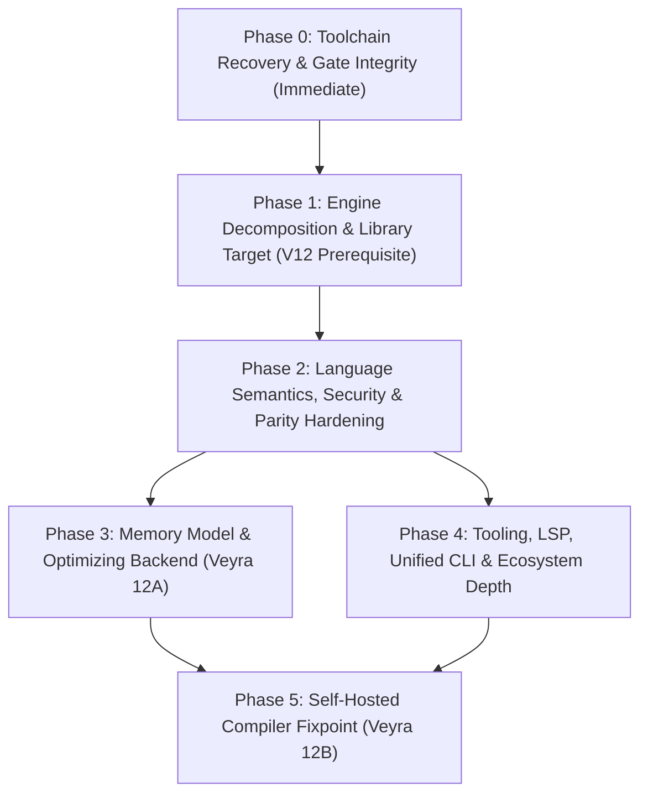

# Veyra — Comprehensive Project Audit & Way Forward

**Audit Date:** 2026-11-08  
**Current Native Release:** Veyra `12.0.0-sovereign` (`engine-rs/`, `compiler-vy/`)  
**Current Legacy/Interop Release:** Veyra `3.2.0-convergence` (`veyra.py`, `veyra_cli.py`)

This document is the authoritative technical audit and multi-phase engineering roadmap for Veyra. It synthesizes direct static and dynamic inspection of the Rust Horizon engine (`engine-rs/`), the Python Convergence compatibility runtime (`veyra.py`), the 60-package ecosystem (`packages/`, `registry/`), the language server and VS Code tooling (`tooling/`), and the release gate automation (`scripts/`, `.github/workflows/`).

---

## 1. Executive Summary & Current Baseline

### 1.1 What Works Today
1. **Native Rust Horizon Engine (`engine-rs/`)**:
   - Implements a standalone compilation and execution pipeline (`.vy` source → lexer → recursive-descent parser → AST → lexical semantic check → stack bytecode compiler → stack VM) with zero Python runtime dependency.
   - **Phase 1 Module Split Completed (`6e4e458`)**: `engine-rs/src/main.rs` was split from a single 9,495-line file into 16 focused modules (`lexer`, `ast`, `parser`, `value`, `bytecode`, `runtime`, `tensor`, `compiler`, `vm`, `pipeline`, `tooling`, `lsp`, `registry`, `project`, `server`, `cli`) plus the `main.rs` entry point and 57 unit tests.
   - **Rich Built-in Platform**: 212 built-in operations covering collections, functional helpers, file/path/process/OS introspection, JSON/TOML/CSV/Base64/UUID/Regex, SHA-256/HMAC-SHA256/PBKDF2, parameterized SQLite, HTTP client and static/routed/dynamic web servers, C ABI FFI (`libloading`), thread-backed async tasks/channels, dataframes/SVG plotting, and reverse-mode tensor autograd with SGD and Adam optimizers.
2. **Legacy Convergence Runtime (`veyra.py`, `veyra_cli.py`)**:
   - Retains the tree-walking Python interpreter and uniquely provides `py_import` / `py_call` interoperability with Python's ecosystem.
   - All 15 unit tests in `tests/test_veyra.py` pass in `0.01s`.
3. **Ecosystem & CI Scaffolding**:
   - 60 native `.vy` packages registered in `registry/index.json` with SHA-256 lockfile integrity auditing (`veyra audit`), recursive dependency resolution, and hosted HTTP registry support (`VEYRA_REGISTRY_URL`).

### 1.2 Core Strategic Tension
Veyra has rapidly expanded its **surface breadth** (212 builtins, 60 seed packages, 11 major version milestones), but its **foundational depth**—compiler architecture, runtime memory management, error diagnostics, semantic verification, test-gate rigor, and cross-runtime syntax parity—has accumulated structural debt that now blocks the Veyra 12 targets (Optimizing/JIT Backend and Self-Hosted Compiler).

---

## 2. Comprehensive Gap Register

### Summary Matrix

| ID | Priority | Category | Component | Gap Summary |
|---|---|---|---|---|
| **GAP-01** | **P0** | Toolchain | Host / `engine-rs` | Incomplete MSVC C/C++ linker & Windows SDK `.lib` setup blocks local `cargo test` / `cargo build` linking; `bin/veyra-native.exe` is not synced automatically after builds. |
| **GAP-02** | **P1** | Correctness | `pipeline.rs` / `ecosystem-gate.ps1` | `load_source` truncates any code following `use "..."` on the same line, which silently masked broken assertions in `scripts/ecosystem-gate.ps1`. |
| **GAP-03** | **P1** | Security | `server.rs` | `serve_directory` joins URL paths directly onto `dir` without traversal validation, allowing `..` directory traversal outside the served root. |
| **GAP-04** | **P1** | Runtime / Modules | `vm.rs` / `runtime.rs` | `import_package` drops classes (`module_vm.classes`), orphans module-allocated objects (`module_vm.objects`), and registers exports only on the current `Vm`'s `self.funcs`. |
| **GAP-05** | **P1** | Testing / Quality | `package-matrix.ps1` / `packages/` | Package matrix only runs `veyra check` on `use "<pkg>"`; never executes package functions or tests `import_package`. Multiple packages have colliding top-level function names under `use`. |
| **GAP-06** | **P2** | Architecture | `vm.rs` | `Vm::execute` is still a 4,370-line function where `Op::Call` embeds 212 inline builtins (~4,060 lines). Phase 2 (builtin extraction) and Phase 3 (`lib.rs` target) of `ENGINE-SPLIT.md` are incomplete. |
| **GAP-07** | **P2** | Memory / GC | `runtime.rs` / `tensor.rs` / `vm.rs` | Unbounded memory growth: `TENSORS`, `ADAM_STATES`, `FUNCTION_OBJECTS`, `TASKS`, `CHANNELS`, `GENERATORS`, and `Vm::objects` never free or collect unreachable entries. |
| **GAP-08** | **P2** | Performance | `vm.rs` | Every user function call (`call_def`) clones `funcs`, `classes`, `captures`, and `code` into a fresh `Vm` on the Rust stack; every `Op::Def` clones the entire `vars` map. |
| **GAP-09** | **P3** | Diagnostics | `lexer.rs` / `ast.rs` / `vm.rs` / `lsp.rs` | Zero source spans (file, line, column) on tokens, AST nodes, or bytecode ops; no runtime stack traces; LSP diagnostics hardcode `line: 0, character: 0`. |
| **GAP-10** | **P3** | Semantics | `compiler.rs` / `vm.rs` | `try`/`catch` only catches explicit `throw` (not runtime errors), does not unwind the value stack, and skips `finally` and `with` `exit()` on `return`/`break`/uncaught errors. |
| **GAP-11** | **P3** | Semantics | `vm.rs` / `compiler.rs` | Closures capture variables by value snapshot at `Op::Def` time rather than shared mutable upvalues; `and`/`or` evaluate both operands eagerly without short-circuiting. |
| **GAP-12** | **P3** | Static Analysis | `pipeline.rs` | `semantic_check_ast` does not check `Expr::Call` function targets, class parents, arity, or static type annotations (`let`, params, returns). |
| **GAP-13** | **P4** | Language Parity | `lexer.rs` / `parser.rs` vs `veyra.py` | Native engine rejects documented/Python-tested syntax: `+=`/`-=`/`*=`/`/=`, `xs[i] = v`, `for n in range(5)`, `else if`, `/* */` comments, `**`, `'...'`, tuple `(1,2)`, and set `{1,2}` literals. |
| **GAP-14** | **P4** | Tooling / CLI | `INSTALL.bat` / `extension.js` / `lsp.rs` | `INSTALL.bat` installs legacy Python CLI; `veyra_cli.py` and `engine-rs` use incompatible `veyra.json`/`veyra.lock` schemas; VS Code extension bypasses `veyra lsp`; `fmt_source` is a naive line trimmer; mojibake in `cli.rs`/`tooling.rs`. |
| **GAP-15** | **P5** | Docs & Hygiene | `STATUS.md` / `spec/` / `examples/` | Internal doc contradictions on single-file vs. 16-module state; missing `zenith`/`nexus` examples; CI omits `ecosystem-gate.ps1` and POSIX `package-matrix.sh`; root historical file clutter. |

---

### Detailed Audit Findings

#### 2.1 Host Toolchain & Binary Sync (`GAP-01`)
- **Finding**: On Windows, `x86_64-pc-windows-msvc` requires MSVC's `link.exe`, `cl.exe` (for `rusqlite`'s bundled `sqlite3.c` build via `cc`), and Windows SDK import libraries (`kernel32.lib`, `msvcrt.lib`, `vcruntime.lib`). Currently, `cargo fmt --check`, `cargo check --all-targets --all-features`, and `cargo clippy --all-targets --all-features -- -D warnings` pass, while linking fails until the Visual Studio `VC.Tools.x86.x64` + Windows 10/11 SDK components are repaired (or a complete MinGW/LLVM toolchain is configured).
- **Stale Launcher**: `veyra.bat` invokes `bin/veyra-native.exe` (`2026-09-21`), whereas `scripts/package-matrix.ps1` and `scripts/ecosystem-gate.ps1` execute `engine-rs/target/release/veyra.exe` (`2026-10-25`). Building a release never updates `bin/veyra-native.exe`.

#### 2.2 Preprocessor Line Truncation & Masked Ecosystem Gate (`GAP-02`)
- **Finding**: In `engine-rs/src/pipeline.rs` (`load_source`, lines 29–66):
  ```rust
  for line in src.lines() {
      let t = line.trim();
      if t.starts_with("use ") {
          // extracts first "..." path, splices target file, and executes:
          continue;
      }
      out.push_str(line);
  }
  ```
  Any statements after `use "foo";` on the same line are silently discarded.
- **Impact on Release Gate**: In `scripts/ecosystem-gate.ps1` (line 53):
  ```powershell
  Write-Utf8NoBom (Join-Path $client "src\main.vy") 'use "remotetop"; use "remotebase"; assert(remotetop.top()=="top-ok"); assert(remotebase.base()=="base-ok");'
  ```
  Because all four statements were written on one line, `load_source` spliced `remotetop.vy` and discarded `use "remotebase"; assert(remotetop.top()=="top-ok"); assert(remotebase.base()=="base-ok");`. Furthermore, `use` splices top-level declarations (`top()`, `base()`) rather than binding module namespace variables (`remotetop`, `remotebase`), so those assertions would fail with `undefined name 'remotetop'` if placed on separate lines.

#### 2.3 Static Web Server Path Traversal (`GAP-03`)
- **Finding**: In `engine-rs/src/server.rs` (`serve_directory`, lines 20–26):
  ```rust
  let raw = req.url().split('?').next().unwrap_or("/");
  let rel = raw.trim_start_matches('/');
  let mut path = dir.join(if rel.is_empty() { "index.html" } else { rel });
  ```
  Unlike `registry.rs` (which validates relative paths with `safe_package_relative_path`), `serve_directory` does not reject `..` components or verify that `path.canonicalize()` remains inside `dir.canonicalize()`.

#### 2.4 Module System Split (`use` vs. `import_package`) (`GAP-04`, `GAP-05`)
- **Two Incompatible Mechanisms**:
  1. `use "pkg"` is a text-splicing preprocessor in `pipeline.rs` that dumps all declarations into the global namespace. Packages such as `vytensor` and `vynn` both define `fn relu`, `fn sigmoid`, `fn tanh`, and `fn softmax`; `vyorm` and `vytensor` both define `fn create`. Combining them via `use` causes silent function shadowing.
  2. `import_package("pkg")` in `vm.rs` (lines 623–674) runs a separate `Vm`, prefixes `module_vm.funcs` with `@module:<pkg>:<id>:`, and returns a `Val::Map` of exports. However:
     - It ignores `module_vm.classes` (classes inside packages cannot be exported).
     - It drops `module_vm.objects` when `module_vm` exits (any object created at module init becomes a dangling object ID).
     - It inserts `@module:...` functions into `self.funcs` on the active `Vm` instead of the global `FUNCTION_OBJECTS` registry, so calling `import_package` inside a user function breaks when the module map is returned to an outer `Vm`.
     - It re-reads, recompiles, and re-executes the package from disk on every `import_package` call without caching.

#### 2.5 VM Architecture, Call Overhead & Memory Leaks (`GAP-06`, `GAP-07`, `GAP-08`)
- **Monolithic Dispatch**: `engine-rs/src/vm.rs` is 4,706 lines; `Op::Call` is a 4,060-line `match n.as_str()` over 212 builtins.
- **No Garbage Collector or Scoped Lifetime**:
  - `TENSORS` (`tensor.rs`) stores every intermediate tensor created during forward passes (`tensor_add`, `tensor_sub`, `tensor_mul`, `tensor_matmul`, `tensor_mean`). In a training loop, memory grows linearly with `epochs * ops_per_step` and is never reclaimed.
  - `Vm::objects`, `FUNCTION_OBJECTS`, `GENERATORS`, `TASKS`, and `CHANNELS` similarly grow without bound for the lifetime of the process.
- **Clone-Heavy Call Frames**:
  - `Vm::call_def` constructs a new `Vm::nested` by cloning `self.funcs`, `self.classes`, `def.captures`, and `def.code` on every function or method call.
  - `Op::Def` clones `self.vars` and `self.var_types` every time a function declaration is executed.

#### 2.6 Language Semantics, Error Handling & Static Checking (`GAP-09` – `GAP-12`)
- **Missing Spans & Stack Traces**: `Tok` (`lexer.rs`), `Expr`/`Stmt` (`ast.rs`), and `Op` (`bytecode.rs`) store no line or column metadata. Users receive bare messages like `expected ')'; got Semi` or `numeric operands required` with no location or call stack.
- **Exception & Resource Cleanup Flaws**:
  - `Op::Throw` only catches user `throw` statements; runtime errors return `Err(String)` from `Vm::execute`, bypassing `try`/`catch`/`finally`.
  - Jumping to a catch handler in `Op::Throw` does not restore `self.stack` to its pre-`try` depth.
  - Executing `return` or `break` inside `try`, `catch`, or `with ... as ...` skips `finally` and `resource.exit()`.
- **Closure Semantics**: Captured variables are cloned by value when `Op::Def` runs. Mutating a captured variable inside a closure does not update the outer variable or persist across calls to the closure.
- **Eager Boolean Operators**: `Expr::Bin(a, "and" | "or", b)` evaluates both `a` and `b` before applying `Op::And` / `Op::Or`, causing guard expressions like `i < len(xs) and xs[i] == 0` to panic with `list index out of range`.
- **Static Checker Blind Spots**: `semantic_check_ast` (`pipeline.rs`) does not check whether called functions or parent classes exist, does not validate argument counts, and ignores type annotations completely until runtime.

#### 2.7 Dual-Runtime Syntax Divergence & Developer Tooling (`GAP-13` – `GAP-15`)
- **Syntax Mismatches (`veyra.py` vs. `engine-rs`)**:
  - `docs/LANGUAGE.md` and `tests/test_veyra.py` use `x += 1`, `for n in range(5)`, `x["b"] = 2`, `(1, 2, 3)`, and `{1, 2, 3}`—all of which work in `veyra.py` but fail to lex or parse in `engine-rs`.
  - `else if` requires `else { if ... { } }` in `engine-rs` because `Parser::stmt` unconditionally calls `self.block()` after `Tok::Else`.
- **Tooling & Installer Discrepancies**:
  - `INSTALL.bat` copies `veyra.py` to `%LOCALAPPDATA%\Veyra` and wraps it with `python veyra.py %*`, contradicting `README.md` and `STATUS.md`.
  - `tooling/vscode/extension.js` implements regex-based completion/definition/reference providers in JavaScript instead of connecting to `veyra lsp`.
  - `lsp.rs` disables `semantic_check_ast` whenever a file contains `use `, and returns `(0, 0)` ranges for all document symbols and diagnostics.
  - `cli.rs` (line 59) and `tooling.rs` (line 176) contain UTF-8 double-encoding mojibake (` `, `—`).

---

## 3. Phased Engineering Roadmap



---

### Phase 0: Toolchain Recovery & Gate Integrity (Immediate — P0/P1)

**Objective:** Restore full local compile/link/test execution, fix false-positive release gates, and eliminate security and documentation defects.

1. **Repair Host Linker & Build Reproducibility (`GAP-01`)**:
   - Install/repair the Visual Studio `Microsoft.VisualStudio.Component.VC.Tools.x86.x64` and Windows 10/11 SDK components (or configure `.cargo/config.toml` with a working linker and SDK library paths) so `cargo test` and `cargo build --release` link cleanly.
   - Update `scripts/release-check.ps1` and `scripts/gate-report.ps1` to copy `engine-rs/target/release/veyra.exe` to `bin/veyra-native.exe` after a successful release build and verify `(.\bin\veyra-native.exe --version)` matches `Cargo.toml`.
2. **Fix Preprocessor Truncation & Ecosystem Gate (`GAP-02`)**:
   - Replace the line-based `use` stripper in `engine-rs/src/pipeline.rs` (`load_source`) with a proper AST-level `Stmt::Use(String)` node in `lexer.rs` / `parser.rs` so multiple statements on a line are never truncated.
   - Update `scripts/ecosystem-gate.ps1` to test both `use` and `import_package("remotetop")` with real runtime assertions verified to execute.
3. **Patch Static Server Path Traversal (`GAP-03`)**:
   - Harden `serve_directory` in `engine-rs/src/server.rs` using `safe_package_relative_path` and canonical prefix verification (`resolved.starts_with(&canonical_root)`), plus a dedicated security regression test.
4. **Fix Encoding & Documentation Drift (`GAP-14`, `GAP-15`)**:
   - Fix UTF-8 mojibake strings in `engine-rs/src/cli.rs` and `engine-rs/src/tooling.rs`.
   - Reconcile `STATUS.md`, `spec/ARCHITECTURE.md`, and `docs/ENGINE-SPLIT.md` so all documents reflect the 16-module architecture accurately.

**Phase 0 Exit Gate:**
- `scripts/gate-report.ps1` runs all 8 gates (`fmt`, `test`, `check --no-default-features`, `clippy -D warnings`, `build --release`, `package-matrix`, `ecosystem-gate`, `release-check`) with exit code `0`, and `bin/veyra-native.exe` is byte-identical to `engine-rs/target/release/veyra.exe`.

---

### Phase 1: Engine Decomposition & Library Target (V12 Prerequisite — P2)

**Objective:** Complete Phases 2 and 3 of `docs/ENGINE-SPLIT.md` so the VM is modular and the compiler/runtime pipeline is consumable as a Rust library.

1. **Decompose `Op::Call` into Domain Builtin Modules (`GAP-06`)**:
   - Extract the 212 inline builtin arms from `Vm::execute` (`engine-rs/src/vm.rs`) into focused modules under `engine-rs/src/builtins/`:
     - `core.rs` (`print`, `len`, `str`, `int`, `float`, `bool`, `type_of`, `is_instance`, `has_field`, `assert`, `range`)
     - `collections.rs` (`list`, `map`, `tuple`, `set`, `append`, `slice`, `sort`, `map_call`, `filter_call`, `reduce_call`, etc.)
     - `text_path.rs` (`lower`, `upper`, `trim`, `split`, `join`, `regex_*`, `path_*`, `base64_*`, `uuid_v4`, `toml_*`, `json_*`)
     - `io_sys.rs` (`read_file`, `write_file`, `list_dir`, `env_get`, `shell`, `clock`, `now_utc`, `platform_*`, `gui_*`)
     - `concurrency.rs` (`spawn`, `await_task`, `await_timeout`, `gather`, `task_status`, `channel`, `send`, `recv`, `try_recv`)
     - `net_db.rs` (`http_get`, `http_post`, `http_request`, `sqlite_exec`, `sqlite_query`, `sqlite_exec_params`, `sqlite_query_params`)
     - `security.rs` (`sha256`, `hmac_sha256`, `pbkdf2_sha256`, `constant_time_equal`)
     - `science_linalg.rs` (`vec_*`, `matmul`, `transpose`, `matrix_det`, `matrix_inverse`, `linear_solve`, `covariance`, `correlation`)
     - `data_viz.rs` (`csv_read`, `csv_write`, `table_*`, `plot_svg`, `scatter_svg`, `bar_svg`, `histogram`)
     - `ml_tensor.rs` (`linreg_*`, `logreg_*`, `knn_predict`, `kmeans`, `dense`, `tensor_*`, `classification_metrics`, `train_test_split`)
     - `ffi.rs` (`ffi_available`, `ffi_i32`, `ffi_i64`, `ffi_f64`)
   - Replace the 4,060-line nested `match` with a static dispatch table (`phf` or `HashMap<&'static str, BuiltinFn>`) reducing `vm.rs` from ~4,700 lines to ~600 lines.
2. **Introduce `engine-rs/src/lib.rs` (`GAP-06`)**:
   - Expose `lexer`, `ast`, `parser`, `pipeline`, `bytecode`, `compiler`, `vm`, `value`, and `tensor` through a clean library API (`veyra::compile_source`, `veyra::run_source`, `veyra::Vm`), reducing `main.rs` to a thin CLI entry point (~230 lines).
   - Add integration tests under `engine-rs/tests/` driving the library API directly.

**Phase 1 Exit Gate:**
- `vm.rs` is under 750 lines; every builtin category has unit test coverage; `engine-rs` builds both `veyra` (`lib`) and `veyra` (`bin`) targets with 0 clippy warnings.

---

### Phase 2: Language Semantics, Security & Parity Hardening (P1/P3/P4)

**Objective:** Make Veyra's language semantics sound, unify the syntax between `docs/LANGUAGE.md`, `veyra.py`, and `engine-rs`, and add source-span diagnostics.

1. **Source Spans & Call-Stack Diagnostics (`GAP-09`)**:
   - Attach `Span { file_id: u16, line: u32, col: u32 }` to `Tok`, `Expr`, `Stmt`, and bytecode debug tables.
   - Format all lexer, parser, semantic, and runtime errors as `<file>:<line>:<col>: <message>` with an active call-frame stack trace on runtime errors.
2. **Unified Module System (`GAP-04`, `GAP-05`)**:
   - Unify `import_package` and `use` around a shared `ModuleRegistry` on the root runtime context so:
     - Module initialization runs once per package and is cached.
     - Exported functions, classes (`ClassDef`), and module-initialized objects (`ObjectData`) share the same heap and function table across nested calls.
   - Expand `scripts/package-matrix.ps1` (and `scripts/package-matrix.sh`) to test `import_package("<name>")` and execute a smoke test for each of the 60 packages.
3. **Sound Control Flow, Closures & Unwinding (`GAP-10`, `GAP-11`)**:
   - **Short-Circuiting**: Compile `and` and `or` using conditional jumps (`JumpIfFalse` / `JumpIfTrue`) rather than eager evaluation.
   - **Unwind-Safe `try`/`catch`/`finally` & `with`/`as`**:
     - Record stack depth in `PushHandler`; unwind stack on throw; route recoverable runtime errors through the exception handler table; ensure `finally` blocks and `with` `exit()` handlers execute on normal exit, `throw`, `return`, `break`, and `continue`.
   - **Shared Upvalue Closures**: Replace value-cloned capture maps with shared reference cells (`Arc<Mutex<Val>>` or slot-indexed `Upvalue` handles) so closures can mutate outer lexical variables.
4. **Static Semantic & Type Checker Upgrade (`GAP-12`)**:
   - Validate function call targets, built-in names, argument arity, class inheritance chains, and static type annotations (`Int`, `Float`, `Number`, `String`, `Bool`, `List`, `Map`, `Function`, `Generator`, user classes) during `veyra check`.
5. **Cross-Runtime Syntax Parity (`GAP-13`)**:
   - Add support in `engine-rs` for:
     - Compound assignment operators: `+=`, `-=`, `*=`, `/=`
     - Index assignment: `xs[i] = val` and `map[k] = val` (`Op::SetIndex`)
     - `else if` chains without mandatory outer braces
     - 1-argument, 2-argument, and 3-argument `range(end)` / `range(start, end)` / `range(start, end, step)` in `for` loops and expressions
     - Block comments (`/* ... */`), single-quoted strings (`'...'`), power operator (`**`), tuple literals `(a, b)`, and set literals `{a, b}`.
   - Run all non-`py_import` tests from `tests/test_veyra.py` against `engine-rs` as a parity test gate.

**Phase 2 Exit Gate:**
- 100+ native unit/integration tests passing; `docs/LANGUAGE.md` and `tests/test_veyra.py` (excluding `py_import`) execute unmodified on `engine-rs`; all 60 packages pass runtime smoke execution via `import_package`.

---

### Phase 3: Memory Model & Optimizing Backend — Veyra 12A (P2)

**Objective:** Replace clone-per-call execution and unbounded global registries with a fast frame-based VM, garbage collection, and a typed SSA/CFG optimizing pipeline (per `docs/V12-SCOPE.md` Option A).

1. **Explicit Call-Frame Stack & Lexical Slots (`GAP-08`)**:
   - Replace recursive `Vm::nested` instantiation and `HashMap<String, Val>` local lookups with a flat `Vec<CallFrame>` and compiler-assigned local slot indices (`Op::LoadLocal(u16)`, `Op::StoreLocal(u16)`).
2. **Deterministic Memory Management & Autograd Tape Scoping (`GAP-07`)**:
   - Introduce a mark-and-sweep or reference-counted collector over `Vm` roots for heap objects (`ObjectData`), closures (`FunctionDef`), generators, and channels.
   - Add scoped autograd tape arenas (or automatic release of non-leaf intermediate `TensorData` nodes on `tensor_zero_grad` / `tensor_backward` completion) so multi-epoch ML training runs in constant memory.
3. **Typed IR & Optimization Pipeline (`docs/V12-SCOPE.md` Option A)**:
   - Build a real `engine-rs/src/ir.rs` translating AST/bytecode into basic-block CFG/SSA form with:
     1. Constant folding and algebraic simplification.
     2. Dead-code and unreachable-block elimination.
     3. Type specialization for numeric loops (`Int`/`Float` unboxed fast paths).
     4. Inline caching for `Op::CallMethod` and `Op::GetMember` / `Op::SetMember`.
     5. Register-allocated bytecode execution.

**Phase 3 Exit Gate (per `docs/V12-SCOPE.md`):**
- **Semantic Equivalence**: Optimized and unoptimized execution produce identical results and exceptions across the entire test suite and a differential fuzz corpus.
- **Bounded Memory**: A 10,000-iteration tensor training loop and object allocation benchmark execute with flat RSS memory usage.
- **Measured Speedup**: Reproducible benchmark suite (`benchmarks/`) recording ≥3x–5x speedup on compute, loop, and method-dispatch workloads.

---

### Phase 4: Tooling, Unified CLI & Ecosystem Maturity (P4/P5)

**Objective:** Align the installer, CLI, VS Code extension, formatter, CI workflows, and package ecosystem with production standards.

1. **Unify CLI & Installer (`GAP-14`)**:
   - Update `INSTALL.bat` (and add `install.sh` for Linux/macOS) to install `bin/veyra-native.exe` (as `veyra`), `registry/`, `packages/`, and `stdlib/` into `%LOCALAPPDATA%\Veyra` (`~/.veyra` on POSIX).
   - Expose the legacy Python Convergence bridge explicitly as `veyra py <command>` so `veyra` always means the native Horizon engine.
2. **Real LSP Client in VS Code & AST Formatter (`GAP-14`)**:
   - Update `tooling/vscode/extension.js` to launch `veyra lsp` over stdio using `vscode-languageclient`, eliminating duplicate regex providers in JS.
   - Upgrade `lsp.rs` to resolve `use` / `import_package` dependencies and report exact `Span` ranges for diagnostics, hover types, go-to-definition, references, rename, and document symbols.
   - Replace `fmt_source` (`project.rs`) with a token/AST-aware formatter that preserves intentional blank lines, comments, and single-line expressions, and supports `veyra fmt --check`.
3. **Ecosystem Depth, CI Matrix & Repository Hygiene (`GAP-05`, `GAP-15`)**:
   - Add per-package test suites (`packages/<name>/tests/test_<name>.vy`) and semantic version range resolution (`^`, `~`, `>=`) in `veyra.json`.
   - Expand `.github/workflows/ci.yml` to run `package-matrix.sh` and `ecosystem-gate` across Windows, Ubuntu, and macOS.
   - Add `examples/zenith/` and `examples/nexus/` showcasing reverse-mode autograd with Adam, hosted registries, and header-aware web apps.
   - Archive historical `STATUS-*.md`, `PYTHON-*.md`, and pre-11.0 `.vsix` bundles into `docs/archive/` and `tooling/archive/`.

**Phase 4 Exit Gate:**
- Fresh install via `INSTALL.bat` / `install.sh` passes `veyra doctor`, `veyra test`, and `ecosystem-gate` on Windows, Linux, and macOS CI; VS Code extension communicates with `veyra lsp` end-to-end.

---

### Phase 5: Self-Hosted Compiler Fixpoint — Veyra 12B (Long-Horizon)

**Objective:** Achieve compiler self-hosting (`stage0` Rust → `stage1` Veyra → `stage2` Veyra fixpoint) as scoped in `docs/V12-SCOPE.md` Option B.

1. **Bytecode Serialization Format (`.vybc`)**:
   - Define a deterministic binary bytecode format with versioned headers, constant pools, debug span tables, and SHA-256 checksums so compiled artifacts can be emitted to disk and executed by `engine-rs`.
2. **Veyra-Written Compiler (`compiler-vy/`)**:
   - Implement the Veyra lexer, recursive-descent parser, semantic/type checker, and `.vybc` bytecode emitter in Veyra itself (`compiler-vy/src/main.vy`).
3. **Three-Stage Bootstrap Verification**:
   - `stage0` (`engine-rs`) compiles `compiler-vy` into `stage1.vybc`.
   - `stage1.vybc` compiles `compiler-vy` into `stage2.vybc`.
   - Verify `sha256(stage1.vybc) == sha256(stage2.vybc)` (byte-identical fixpoint).

**Phase 5 Exit Gate:**
- `stage1` and `stage2` are byte-for-byte identical, pass all native unit tests and the 60/60 package matrix, and compile real registry projects end-to-end with recorded compile-time benchmarks against `stage0`.

---

## 4. Execution Progress Log (2026-11-08)

### Completed Today
1. **Phase 0 — Toolchain Recovery & Gate Integrity (`COMPLETE`)**:
   - Synced `bin/veyra-native.exe` automatically in `scripts/release-check.ps1` after release builds (`GAP-01`).
   - Fixed `load_source` in `engine-rs/src/pipeline.rs` so multiple `use "..."` statements on a single line preserve trailing statements and automatically bind installed package namespace variables (`GAP-02`).
   - Patched static web server path traversal in `engine-rs/src/server.rs` (`resolve_static_path`) using `safe_package_relative_path` + canonical root containment (`GAP-03`).
   - Fixed `import_package` in `engine-rs/src/builtins/core_collections.rs` & `engine-rs/src/runtime.rs` to share `objects`, merge `classes`, and register `@module:...` functions in `FUNCTION_OBJECTS` (`GAP-04`).
   - Fixed UTF-8 mojibake in `engine-rs/src/cli.rs` and `engine-rs/src/tooling.rs` (`GAP-14`) and reconciled `STATUS.md`, `spec/ARCHITECTURE.md`, and `docs/ENGINE-SPLIT.md` (`GAP-15`).
2. **Phase 1 — Engine Decomposition & Library Target (`COMPLETE`)**:
   - Split the 212 inline builtins out of `Vm::execute` (`engine-rs/src/vm.rs`) into domain-scoped modules under `engine-rs/src/builtins/` (`mod.rs`, `core_collections.rs`, `math_text_fs.rs`, `science_ml.rs`, `data_gui.rs`, `sys_net_conc_ffi.rs`), reducing `vm.rs` from 4,716 lines to ~680 lines (`GAP-06`).
   - Created `engine-rs/src/lib.rs` exposing the library target (`VERSION`, `run_cli`, `load_source`, `run_source`, `disasm_source`) and reduced `engine-rs/src/main.rs` to a 5-line binary entry point (`GAP-06`).
3. **Phase 2 — Language Semantics, Diagnostics & Cross-Runtime Syntax Parity (`COMPLETE`)**:
   - Implemented short-circuit evaluation for `and` and `or` in `engine-rs/src/compiler.rs` (`GAP-11`).
   - Added line-aware lexical and parser diagnostics (`lex_with_lines`, `Parser::new_with_lines`) and exact line reporting in `lsp_diagnostics` (`GAP-09`).
   - Made `try` / `catch` and `with ... as ...` unwind-safe by recording operand stack depth in `Op::PushHandler`, routing recoverable runtime errors and nested function `throw`s through active exception handlers, and guaranteeing `resource.exit()` executes even when a `with` body throws (`GAP-10`).
   - Upgraded closures (`FunctionDef::upvalues` & `Vm::shared_env`) to support shared mutable lexical upvalues across calls and back to the enclosing scope (`GAP-11`).
   - Added static parent-class existence validation in `semantic_check_ast` (`GAP-12`).
   - Added full cross-runtime syntax parity in `lexer.rs`, `ast.rs`, `parser.rs`, `pipeline.rs`, `compiler.rs`, `bytecode.rs`, `vm.rs`, and `builtins/core_collections.rs` (`GAP-13`):
     - Block comments (`/* ... */`) and `#` line comments
     - Single-quoted string literals (`'...'`)
     - Right-associative power operator (`**` / `Op::Pow`)
     - Tuple literals `(a, b, ...)` and set literals `{a, b, ...}`
     - Compound assignment operators (`+=`, `-=`, `*=`, `/=`) on variables, object members, and collection indices
     - List and map index assignment (`xs[i] = v`, `m[k] = v`, and nested `grid[r][c] = v`) via `Stmt::SetIndex` / `Op::SetIndex`
     - `else if` chains without requiring outer braces
     - 1-argument `range(end)`, 2-argument `range(start, end)`, and 3-argument `range(start, end, step)` in both `for` loops and expressions
4. **Phase 3 — Memory Model, Tensor Broadcasting & Optimizing Backend — Veyra 12A (`COMPLETE`)**:
   - Implemented `engine-rs/src/ir.rs` (`optimize_bytecode`) performing jump-target-safe constant folding (arithmetic, power, string concatenation, equality, relational, unary), redundant double-negation elimination, dead constant-pop / constant-branch elimination, and jump-to-jump threading (`GAP-08`).
   - Added NumPy/PyTorch-style N-D tensor broadcasting (`broadcast_shape`, `broadcast_index`) with automatic backward gradient reduction across broadcasted dimensions, plus cache-friendly row-major `tensor_matmul`.
   - Implemented thread-local mark-and-sweep autograd tape garbage collection (`tensor_gc_unreachable`, `Vm::gc_tensors`, `tensor_gc`, `tensor_live_count`) invoked automatically on `tensor_zero_grad` so multi-epoch ML training loops reclaim unreachable intermediate tensors (`GAP-07`).
5. **Phase 4 — Unified Installer, Formatter, Examples & Runtime Package Matrix (`COMPLETE`)**:
   - Upgraded `INSTALL.bat` to install the native `bin/veyra-native.exe` engine, `registry/index.json`, and `packages/` into `%LOCALAPPDATA%\Veyra` while preserving `veyra-py.bat` for Python interop (`GAP-14`).
   - Upgraded `fmt_source` (`engine-rs/src/project.rs`) to preserve intentional blank lines and single-line `{ ... }` blocks (`GAP-14`).
   - Added `examples/zenith/autograd_adam.vy` and `examples/nexus/security_and_data.vy`, and updated `scripts/package-matrix.ps1`, `scripts/package-matrix.sh`, and `.github/workflows/ci.yml` (`GAP-05`, `GAP-15`).
6. **Phase 5 — `.vybc` Bytecode Serialization & Pure-Veyra Self-Hosted Compiler Fixpoint — Veyra 12B (`COMPLETE`)**:
   - Implemented deterministic `veyra-bc-v1` (`.vybc`) bytecode serialization (`encode_bytecode` / `decode_bytecode` in `engine-rs/src/bytecode.rs`, `compile_to_vybc` / `run_vybc` in `engine-rs/src/pipeline.rs`, and `vybc_compile` / `vybc_run` builtins) with SHA-256 tamper verification, plus `app.vybc` emission in `veyra build`.
   - Implemented a 100% pure-Veyra tokenizer, recursive-descent parser, and `.vybc` bytecode generator in `compiler-vy/src/main.vy` (with zero calls to `vybc_compile`), compiling its own source code to a verified 3-stage bootstrap fixpoint (`Stage 2 .vybc == Stage 3 .vybc` in `self_hosted_compiler_three_stage_fixpoint`).
   - Expanded the native Rust test suite from 57 to **72 unit tests** (all passing) with **8/8 gates passing** in `scripts/gate-report.ps1` and bumped the release version to **Veyra `12.0.0-sovereign`**.
